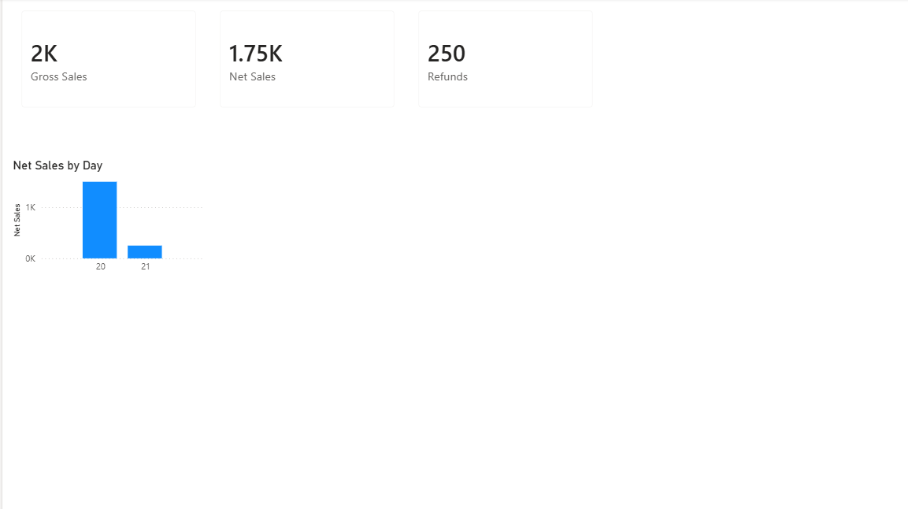
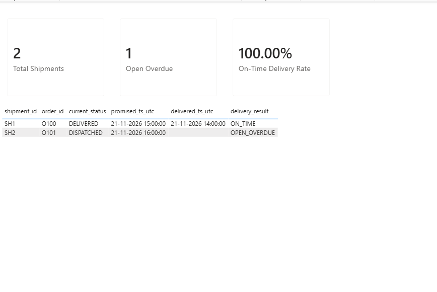
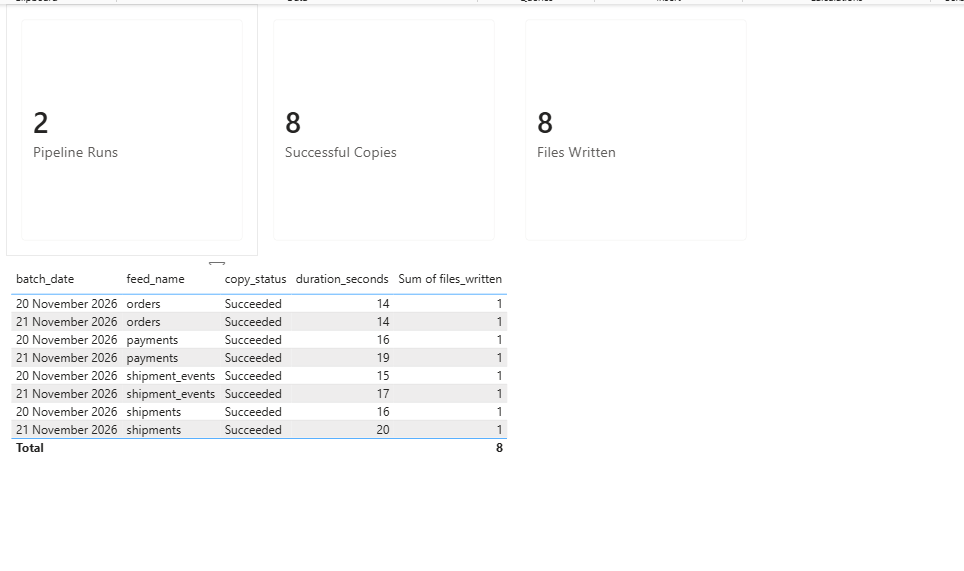

# Retail Order Fulfillment Lakehouse

This project ingests synthetic retail batches with Azure Data Factory, transforms them into Delta tables in Databricks, queries Gold Parquet exports with Synapse serverless SQL, and presents the results in Power BI Desktop.

## What the project demonstrates

- **Ingestion.** A published ADF pipeline looks up feed mappings from a CSV and copies each listed feed into a dated ADLS Gen2 path. The four-feed runs cover orders, payments, shipments, and shipment events. Azure Monitor archives pipeline and activity logs.
- **Transformations.** Databricks notebooks retain source metadata in Bronze, validate typed orders, payments and refunds in Silver, and produce daily revenue and shipment detail in Gold.
- **Reporting.** Synapse reads versioned Gold Parquet exports. Power BI Desktop uses CSV snapshots from the verified queries and a local ADF diagnostic extract. The lab transfers files manually between Azure Storage and the Databricks trial workspace.
- **Streaming.** Auto Loader with an AvailableNow trigger resumes from its checkpoint when a new shipment event file appears. A separate batch test checks duplicates, malformed timestamps, and sequence ordering. Carrier reconciliation checks both matching and stale sequences.

## Run the lab

1. Read the [source data contracts](docs/source-data-contracts.md) and [design and release plan](docs/design-and-release-plan.md). Generate fixtures from the repository root with `python src/generate_fixtures.py --output data/fixtures`.
2. Stage the clean CSVs for the four feeds in the source container under `<feed>/batch_date=YYYY-MM-DD/<feed>.csv`. Upload [feeds.csv](config/feeds.csv) at the root of the control container. Configure the ADF linked service and container permissions for the target environment, and run `pl_retail_ingest_batch` for both dates.
3. Import the [Databricks source notebooks](databricks/notebooks). For the trial setup, place the November 21 orders and payments CSVs at the root of `retail_raw` and the November 20 pair in its dated folder. Load November 21 with a root source path before running the saved November 20 backfill. Stage the refund, shipment and carrier files in their dated folders. Review each notebook’s input paths and cells before running in numbered order. Stage the two stream files one at a time and reuse the same checkpoint to test restart behavior.
4. Upload the revenue and shipment Parquet exports to the Gold container. Run the [Synapse SQL scripts](synapse/sql) on the built-in serverless endpoint with storage read access. Replace the storage account hostname for a different environment.
5. Export the Synapse query results to CSV for Power BI. Build the three report pages from the SQL snapshots and the ADF activity extract with run identifiers removed before public sharing.

## Verified results

- Revenue reconciled to INR 2,000 gross sales, INR 250 refunds, and INR 1,750 net sales. The refund was recognized on its posting date.
- Fulfillment showed two shipments, one delivered on time and one open overdue at the November 21 UTC cutoff.
- Archived ADF logs showed two successful pipeline runs and eight successful copy activities.
- The file-based stream processed four unique fixture events across two input files. Its latest state matched both carrier records. A simulated stale carrier sequence flagged only SH1.

## Power BI report

### Executive Revenue

### Fulfillment Operations

### Data Reliability

## Release checklist

- Review the notebook source, SQL scripts, fixture generator, feed configuration, and report screenshots in a pull request.
- Verify the screenshots render and the documentation links resolve from the repository root.
- Record the successful ADF run, Bronze replay, finance reconciliation, shipment quality test, checkpoint restart, and carrier mismatch test.
- Publish synthetic fixtures and cropped screenshots. Keep original diagnostic logs and local credentials in private storage.
- Track Event Hubs integration, automated file handoffs, and a refreshable Power BI connection as follow-up work.
